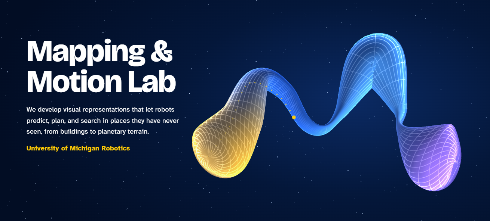

We develop visual representations that let robots predict, plan, and search in places they have never seen, from buildings to planetary terrain.

**[Lab website](https://m-and-m-lab.github.io)** for new research, people, and project pages.
**[Contact form](https://forms.gle/8UWUpDH4bdLeTq5Y8)** if you are interested in doing research with the lab.

## Simulation software

- **[PhyGS](https://github.com/m-and-m-lab/PhyGS)**: photorealistic, building-scale indoor scenes with working physics in IsaacSim, with an agent stack and hardware abstraction layer for Boston Dynamics Spot with Arm. Beta.
- **[HydroShear](https://github.com/MMintLab/hydroshear)**: tactile simulation for sim-to-real reinforcement learning, developed with the MMint Lab.

Many other repositories here are working forks of tools we build on.
